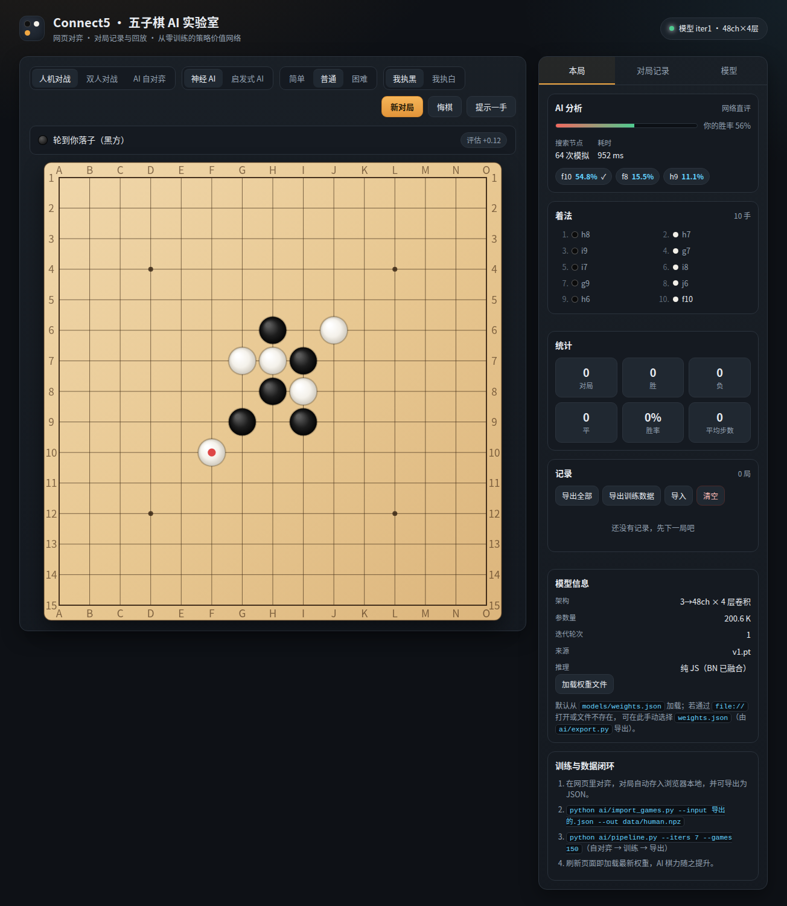

# Connect5 · 五子棋 AI 实验室

一个从零开始的五子棋项目：可玩的网页对弈、完整的对局记录与回放，以及一个**完全从零训练**的五子棋神经网络 AI（自对弈 + MCTS + 迭代训练），训练好的模型会直接在浏览器里以纯 JS 推理的方式与你下棋。

```
网页对弈 ──导出对局──▶ 训练数据 ──▶ 自对弈 + 训练 ──▶ 权重 ──▶ 网页 AI 变强
```

## 目录结构

```
Connect5/
├── TRAINING.md              # 训练全流程说明（手动分步、参数速查、避坑）
├── MODEL_HISTORY.md         # 正式版本演进史：每一代正式版的训练配方与实战成绩
├── EXPERIMENTS.md           # 实验记录：所有 *_test 实验版本（正式版不在此）
├── ai/                      # 训练侧（Python + PyTorch）
│   ├── gomoku.py            #   规则引擎、特征编码、启发式基线
│   ├── model.py             #   策略-价值网络（BN 可融合导出）
│   ├── mcts.py              #   PUCT 蒙特卡洛树搜索（批量叶子评估 + 虚拟损失）
│   ├── selfplay.py          #   自对弈数据生成（多进程）
│   ├── train.py             #   训练（策略交叉熵 + 价值 MSE + 对称增强）
│   ├── evaluate.py          #   模型 vs 基线/旧模型对战评估
│   ├── export.py            #   导出网页端权重（BN 融合 + base64 float32）
│   ├── import_games.py      #   把网页记录的对局转成训练样本
│   ├── pipeline.py          #   一键迭代：自对弈 → 训练 → 导出 → 评估
│   └── requirements.txt
├── web/                     # 网页端（零依赖，纯静态）
│   ├── index.html
│   ├── css/style.css
│   ├── js/rules.js          #   规则与启发式（与 Python 端语义一致）
│   ├── js/nn.js             #   纯 JS 卷积网络推理（im2col + GEMM）
│   ├── js/ai.js             #   MCTS 玩家 + 一步杀/必防战术检查
│   ├── js/board.js          #   Canvas 棋盘渲染与交互
│   ├── js/storage.js        #   localStorage 对局记录、导入导出
│   ├── js/main.js           #   主流程
│   └── models/weights.json  #   训练导出的权重（AI 的大脑）
├── data/                    # 训练数据（npz / jsonl）
├── models/
│   ├── v1/                  # v1 系列正式版（20 万参数 → 浏览器推理）
│   ├── v2/                  # v2 系列正式版（116 万参数 → 后端推理）
│   └── experiments/         # ★ 所有实验版本权重（*_test / *_repro）
├── logs/                    # 所有运行日志，按类型分目录
│   ├── train/               #   训练      train_<版本>.log
│   ├── selfplay/            #   数据生成  selfplay_<产物>.log
│   ├── eval/                #   评估报告  <版本>-vs-<对手>.log
│   └── service/             #   后端服务  server.log
└── docs/                    # 文档配图
```

### 文件摆放规范

跑任何脚本，产物都要落到对应目录，**不要散落在项目根目录**：

| 产物 | 目录 | 命名 |
| --- | --- | --- |
| 训练日志 | `logs/train/` | `train_<版本>.log` |
| 数据生成日志 | `logs/selfplay/` | `selfplay_<产物>.log` |
| 评估报告 | `logs/eval/` | `<版本>-vs-<对手>.log` |
| 服务日志 | `logs/service/` | `server.log` |
| 训练数据 | `data/` | `<来源>_<规模>.npz` |
| 正式版权重 | `models/<系列>/` | `v2_2.pt`（与版本名对应） |
| **实验版权重** | **`models/experiments/`** | `v2_2_test_xxx.pt` |

对应的命令写法：

```bash
cd ai
python3 train.py    ... 2>&1 | tee ../logs/train/train_v2.3_test_xxx.log
python3 selfplay.py ... > ../logs/selfplay/selfplay_xxx.log 2>&1 &
python3 evaluate.py ... > ../logs/eval/vN-vs-heuristic.log  2>&1 &
```

版本命名（正式版 / 实验版）见
[MODEL_HISTORY.md](MODEL_HISTORY.md) 开头的「📐 版本命名规范」。

## 快速开始



### 1. 打开网页下棋

```bash
cd web
python3 -m http.server 8080
# 浏览器打开 http://127.0.0.1:8080
```

> 需要通过 http 打开（权重文件用 fetch 加载）；若直接双击 `index.html`，
> 可在页面「模型」标签里手动选择 `web/models/weights.json`。

页面功能：

* 三种模式：人机对战 / 双人对战 / AI 自对弈（观战并自动产生对局数据）
* AI 三档强度（简单 16 sims、普通 64 sims、困难 240 sims），可选择执黑或执白
* 落子动画、最后一手标记、胜利连线高亮、悬停预览
* AI 分析面板：胜率评估、搜索次数、耗时、Top3 候选点
* 「提示一手」给出当前推荐落子
* 每局自动保存到浏览器本地，可回放、删除、导出

### 2. 从零训练 AI

完整的分步说明见 **[TRAINING.md](TRAINING.md)**（每条命令在做什么、耗时、怎么判断变强、常见坑）。
这里只给最短路径：

```bash
pip install -r ai/requirements.txt
cd ai

# 全自动：冷启动 + 6 轮迭代自对弈，每轮自动导出并评估
python3 pipeline.py --iters 7 --games 150 --sims 64 --epochs 3 --workers 12 --eval-games 20
```

每一轮做四件事：

1. **自对弈**：第 0 轮用启发式策略冷启动；之后用上一轮模型 + MCTS 自对弈（根噪声 + 温度退火）。
2. **训练**：在最近若干轮数据（经验回放窗口）上训练，8 种对称增强。
3. **导出**：融合 BN 后写入 `web/models/weights.json`，网页刷新即生效。
4. **评估**：与启发式贪心基线对弈，输出胜率。

也可以分步执行：

```bash
python3 selfplay.py --policy heuristic --games 300 --workers 12 --out ../data/iter0.npz
python3 train.py --data ../data/iter0.npz --epochs 3 --out ../models/iter0.pt
python3 export.py --model ../models/iter0.pt --out ../web/models/weights.json
python3 evaluate.py --model ../models/v1/latest.pt --vs heuristic --games 20 --sims 64
```

### 3. 用人类对局反哺训练（数据闭环）

1. 在网页「对局记录」里点 **导出训练数据**，得到 `connect5-training-*.json`
2. 转成训练样本并与自对弈数据一起训练：

```bash
python3 import_games.py --input ../data/human/connect5-training.json --out ../data/human.npz --winners-only
python3 train.py --data ../data/heur2000.npz ../data/human.npz --init ../models/v1/latest.pt --epochs 2 --lr 3e-4
```

### 4. 当前模型棋力（v1 实测）

| 难度 | MCTS sims | v1 | **v1.1** | 变化 |
| --- | --- | --- | --- | --- |
| 简单 | 16 | 28.3% | **33.3%** | +5.0 |
| 普通 | 64 | 25.0% | **36.7%** | **+11.7** |
| 困难 | 240 | 25.0% | **36.7%** | +11.7 |
| vs 随机 | 32 | 100% | **100%** | 持平 |

（对手为启发式贪心，30 局双方各半先手。v1.1 策略准确率 0.416、value loss 0.517。）

v1.1 用「知识增强搜索」自对弈 600 局（平局率从 64% 降到 8.6%）补齐了胜负信号，
让价值头第一次学到东西——v1 时代"64 次模拟和 240 次结果一样"的怪象，
在 v1.1 上变成了"深搜索确实比浅搜索强"。

20 万参数的模型大致是「打随机碾压、打贪心基线两成半得分率」。
所有 AI 落子前都会过一遍强制手检查（成五 → 堵五 → 造活四 → 堵活四），所以不会漏杀漏防。

值得注意的是：**搜索越深并没有变强**（16 → 240 sims，得分率反而略降），
瓶颈在网络质量而非模拟次数。完整记录见 [MODEL_HISTORY.md](MODEL_HISTORY.md)。

继续提升：见 [TRAINING.md](TRAINING.md) 第 9 节——以 v1 为地基跑迭代自对弈
（网络已有棋型概念，MCTS 先验才有信息量，迭代循环才转得动）。

## AI 设计

**输入表示**（相对视角，3×15×15）

| 通道 | 含义 |
| --- | --- |
| 0 | 当前行棋方的棋子 |
| 1 | 对手的棋子 |
| 2 | 常数平面：轮到黑棋为 1，否则为 0 |

**网络结构**（约 20 万参数）

```
3×15×15 → Conv3×3(48)+BN+ReLU → [Conv3×3(48)+BN+ReLU] ×4
        ├─ policy head: Conv1×1(2)+BN+ReLU → FC(450→225)  → 落子 logits
        └─ value  head: Conv1×1(1)+BN+ReLU → FC(225→64) → FC(64→1) → tanh
```

**训练目标**

* 策略：MCTS 访问分布的软标签交叉熵
* 价值：对局结果 z ∈ {+1, -1, 0}（当前行棋方视角）的 MSE
* 8 种对称（旋转 + 翻转）数据增强，Adam + 余弦退火

**搜索**：PUCT-MCTS，叶子节点攒够 batch 再批量推理，虚拟损失避免多条模拟撞同一叶子；
自对弈时加 Dirichlet 根噪声并做温度退火；对局/网页端额外做「一步成五」与「必封堵」的战术检查。

**浏览器推理**：`js/nn.js` 用 im2col + GEMM 实现卷积（BN 已在导出时融合进卷积权重），
单次前向约 13–20 ms，与 PyTorch 的输出误差在 1e-7 量级（float32 精度）。

## 说明

* 规则为标准无禁手五子棋：横、竖、斜任一方向先连成五子获胜，棋盘下满为平局。
* 自对弈与训练默认使用 GPU（显存不足时自动回退 CPU），可通过 `--cpu` / `--workers` 调整。
* 对局记录保存在浏览器 localStorage（最多 500 局），导出格式为 `ai/import_games.py` 可直接读取的 JSON。
